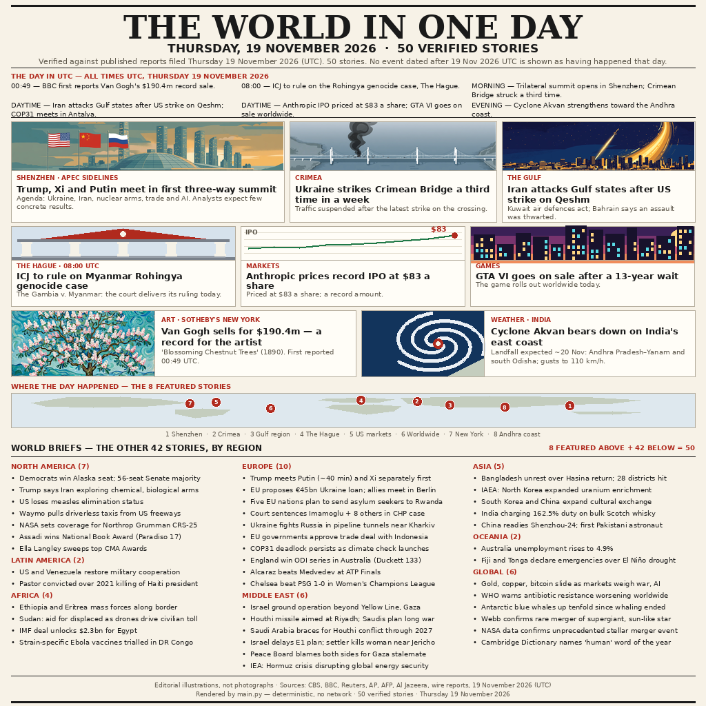

# The World in One Day — Thursday 19 November 2026

[](https://make.fun/bounty/news-image-20261119?utm_source=github&utm_medium=readme&utm_campaign=news-image-20261119)
[](https://make.fun/bounty/news-image-20261119/leaderboard?utm_source=github&utm_medium=readme&utm_campaign=news-image-20261119)
[](https://make.fun/bounty/news-image-20261119?utm_source=github&utm_medium=readme&utm_campaign=news-image-20261119)

A one-page newspaper front page for **Thursday 19 November 2026** — **50 verified
stories**, a UTC timeline, a world-map strip marking the 8 featured stories, and
world briefs grouped by continent.



## What the image shows

- **Masthead** — "THE WORLD IN ONE DAY", the date, "50 VERIFIED STORIES", and an
  explicit date check: every story is verified against published reports filed
  Thursday 19 November 2026 (UTC); nothing dated after that day is shown as
  having happened that day.
- **The Day in UTC** — a chronological strip. Only two precise times are
  sourced: the Van Gogh sale first reported **00:49 UTC** (BBC) and the ICJ
  ruling at **08:00 UTC**; everything else uses day-part labels (Morning /
  Daytime / Evening).
- **8 featured stories** — the first three-way Trump–Xi–Putin summit in
  Shenzhen; Ukraine's third strike on the Crimean Bridge in a week; Iran's
  attacks on Gulf states after the US strike on Qeshm Island; the ICJ ruling
  on the Myanmar Rohingya genocide case; Anthropic's record IPO at $83 a
  share; GTA VI going on sale after a 13-year wait; Van Gogh's "Blossoming
  Chestnut Trees" (1890) selling for $190.4m, a record for the artist; and
  Cyclone Akvan bearing down on India's east coast.
- **World Briefs** — the other 42 stories, grouped by continent: North America
  (7), Latin America (2), Europe (10), Middle East (6), Africa (4), Asia (5),
  Oceania (2), Global (6). 8 featured + 42 briefs = 50.
- **Footer** — sources: CBS, BBC, Reuters, AP, AFP, Al Jazeera and wire
  reports, 19 November 2026 (UTC).

## Wording care

- The trilateral summit is reported as a first-ever three-way meeting with its
  agenda (Ukraine, Iran, nuclear arms, trade, AI) and "few concrete results
  expected" — no agreement or outcome is claimed.
- The ICJ ruling is set for 19 Nov 08:00 GMT; the headline says "to rule" —
  the verdict content is not claimed.
- The Crimean Bridge was struck a third time in a week and traffic was
  suspended — no collapse is claimed.
- The Van Gogh sale was reported 19 Nov 00:49 UTC (BBC); the sale itself took
  place on Wednesday evening in New York.
- Anthropic's IPO is priced at $83 a share, a record amount — no valuation is
  stated.
- No quotes, numbers or outcomes are invented. Every number in the image is
  sourced from the wire reports listed above.

## How to run

```sh
python3 main.py
```

- Python 3 stdlib only, plus Pillow for rendering. No network access.
- Renders `entry.png` (1024×1024, ≤ 1 MiB) next to `main.py`, verifies the
  PNG (signature, per-chunk CRC, IHDR ≤ 1024, IEND, no trailing bytes), then
  copies it to `/output/entry.png`.
- Deterministic: two runs produce a byte-identical `entry.png`.

## Files

| File | What it is |
| --- | --- |
| `main.py` | The whole program: data, layout, Pillow art, PNG verification |
| `entry.png` | The rendered front page (1024×1024) |
| `assets/f1.png`, `f2.png`, `f3.png`, `f7.png` | Flat editorial illustrations (generated, no text, no faces) for the Shenzhen summit, Crimean Bridge, Gulf and Van Gogh panels; the other four panels are drawn with Pillow |
| `LICENSE` | MIT |

## License

MIT — see [LICENSE](LICENSE).
